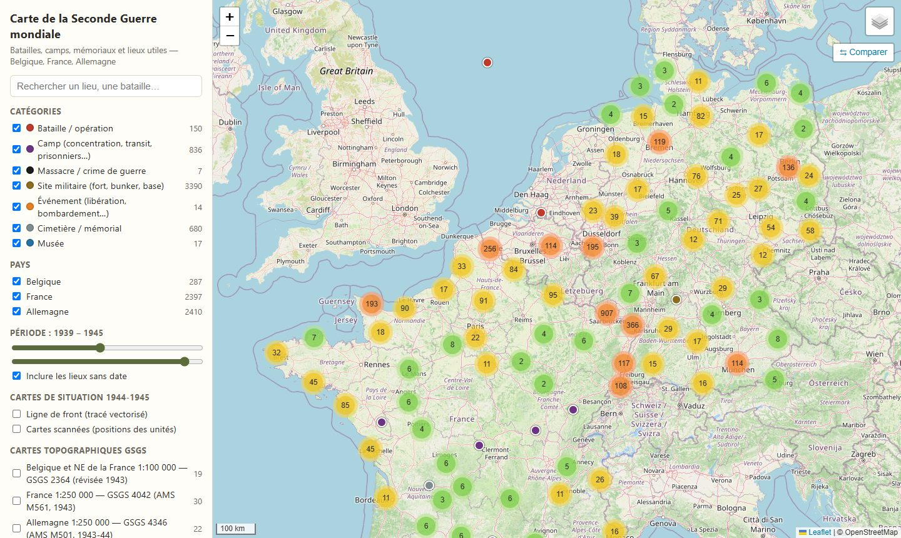
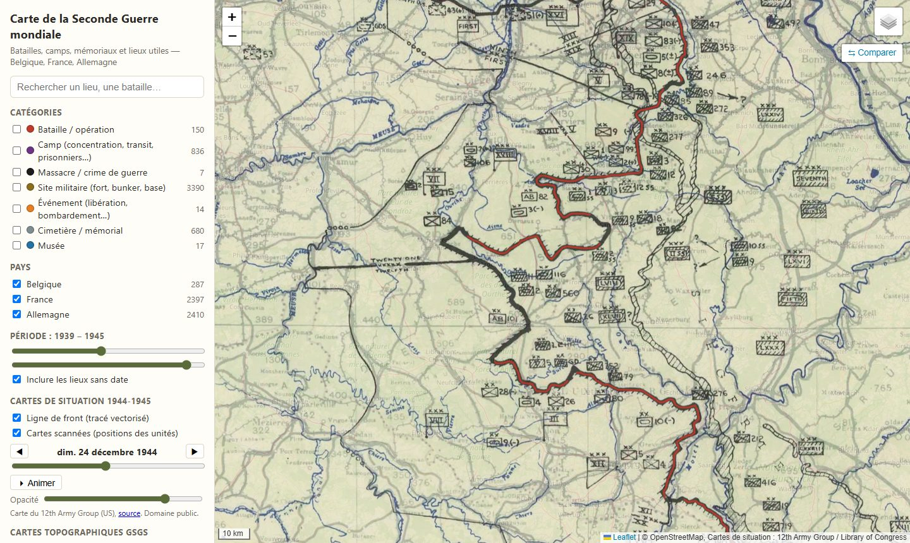
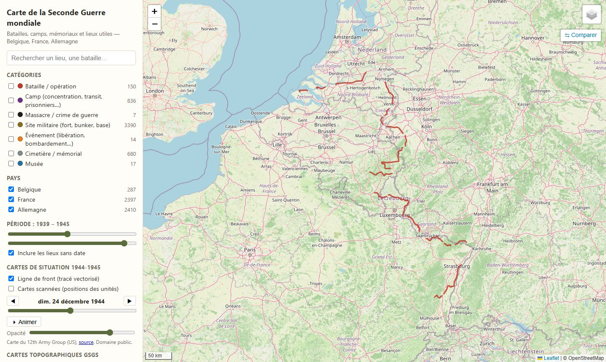
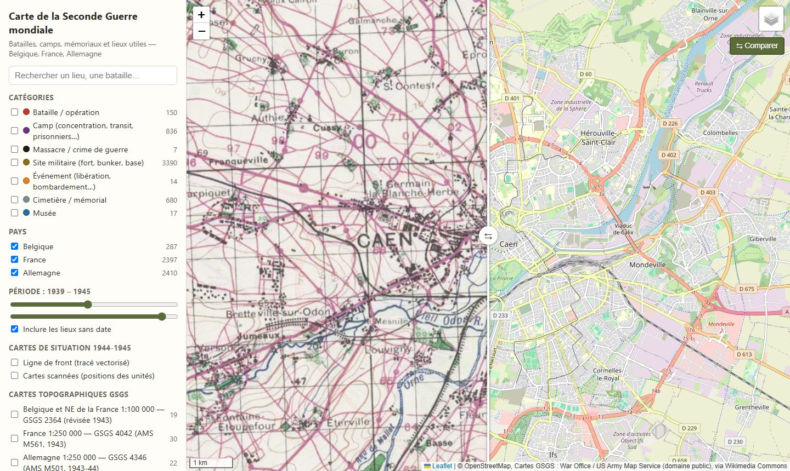
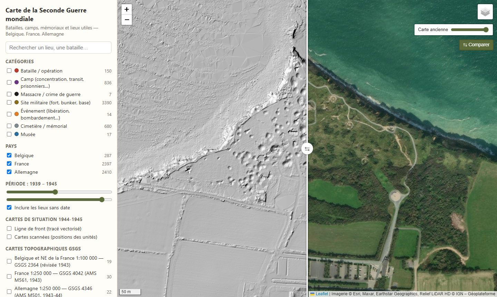
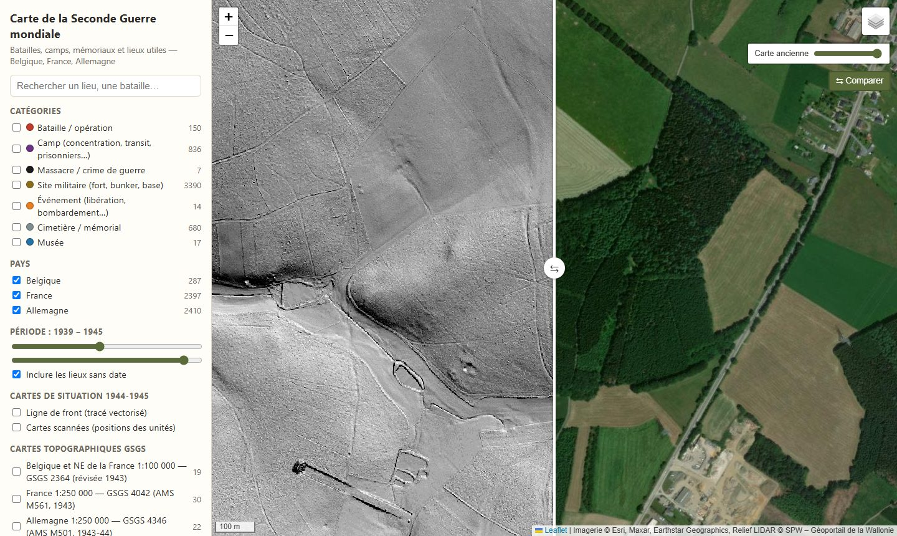
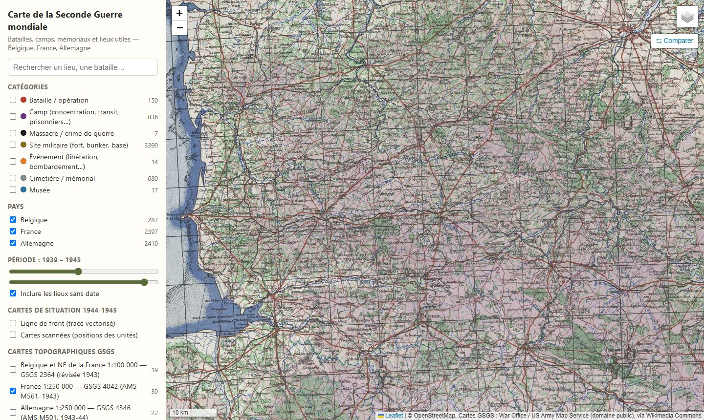

# Carte de la Seconde Guerre mondiale — Belgique, France, Allemagne

Carte interactive des lieux de la Seconde Guerre mondiale, construite à partir d'archives publiques. On y trouve près de 5 000 lieux : batailles, camps, massacres, bunkers, cimetières, mémoriaux et musées. On peut y superposer les cartes de situation alliées de 1944-1945, jour par jour, et des cartes militaires de 1943 calées sur la carte actuelle. Le relief LIDAR et l'imagerie satellite servent à comparer avec le terrain d'aujourd'hui.



## Télécharger

**Windows : [WW2Map.exe dans la dernière version](https://github.com/LaurentJack/WW2Map/releases/latest)** (≈ 720 Mo).

Ce fichier unique contient toute l'application : double-cliquez dessus, rien à installer. Windows peut afficher « éditeur inconnu », car l'exe n'est pas signé : cliquez « Informations complémentaires », puis « Exécuter quand même ». Les fonds de carte, le satellite et le LIDAR demandent une connexion internet ; le reste fonctionne hors ligne.

**Autres systèmes :** clonez le dépôt, puis servez-le en local :

```bash
git clone https://github.com/LaurentJack/WW2Map.git
cd WW2Map
python -m http.server 8765
```

puis ouvrez http://localhost:8765.

## Ce qu'on peut faire

### Suivre les opérations jour par jour, du débarquement à la capitulation

Les 419 cartes de situation du 12th Army Group américain (juin 1944 – juillet 1945) sont calées sur la carte actuelle. Un curseur choisit la date, et le bouton « Animer » fait défiler les jours. Ci-dessous, la bataille des Ardennes le 24 décembre 1944 : les unités sont celles de la carte d'époque, la ligne rouge est le front.



### La ligne de front seule, sur la carte actuelle

Le tracé du front a été extrait automatiquement des cartes scannées pour 273 dates. On peut l'afficher sur le fond actuel et l'animer.



### Comparer 1943 et aujourd'hui

Le bouton « ⇆ Comparer » coupe la carte en deux : à gauche la couche ancienne, à droite la carte actuelle. On fait glisser la poignée. Ici, Caen sur la carte britannique au 1:100 000 utilisée pour la bataille de Normandie.



### Voir le terrain sous la forêt : LIDAR et satellite

Le relief LIDAR de France (LiDAR HD de l'IGN), de Wallonie et de Flandre montre le sol sans la végétation. À la pointe du Hoc, les cratères des bombardements du 6 juin 1944 criblent encore le terrain :



En Belgique, le principe est le même. Autour de Bastogne, on distingue encore les trous d'obus, les tranchées et les trous de combat de l'hiver 1944, invisibles sur la photo satellite.



### Cartes topographiques militaires de 1943

Les cartes britanniques GSGS (éditions de l'US Army Map Service) sont calées sur la carte actuelle :

| Série | Feuilles |
|---|---|
| France 1:250 000 (GSGS 4042) | 30 |
| Allemagne 1:250 000 (GSGS 4346) | 22 |
| Belgique et nord-est de la France 1:100 000 (GSGS 2364) | 19 |
| Normandie 1:100 000 (GSGS 4249) | 12 |



### Et aussi

- Filtres par catégorie, pays, période et source ; recherche plein texte ; fiche de chaque lieu, avec liens Wikipédia et Wikidata.
- Couches historiques : carte de France 1950 et photos aériennes 1950-1965 (IGN), photos de 1947 du Calvados, carte d'état-major du XIXe siècle, photos aériennes de la Wallonie (1971) et de Berlin (1953).

## Sources et licences

| Données | Source | Licence |
|---|---|---|
| Lieux | Sélection manuelle, [Wikidata](https://www.wikidata.org), [EHRI](https://www.ehri-project.eu) (camps et sous-camps), [OpenStreetMap](https://www.openstreetmap.org) (bunkers, champs de bataille) | CC0 (Wikidata) ; ODbL (© contributeurs OpenStreetMap) |
| Cartes de situation 1944-1945 | 12th Army Group, Library of Congress, via Wikimedia Commons | Domaine public |
| Cartes GSGS 1943 | War Office / US Army Map Service, Perry-Castañeda Library (université du Texas) | Domaine public |
| Relief LIDAR | IGN (LiDAR HD) ; SPW – Géoportail de la Wallonie ; Digitaal Vlaanderen | Données ouvertes (Licence Ouverte Etalab pour l'IGN) |
| Cartes et photos anciennes | IGN – Géoplateforme ; SPW ; Geoportal Berlin | Licences ouvertes des fournisseurs |
| Fonds de carte | OpenStreetMap, OpenTopoMap, Esri World Imagery | ODbL, CC-BY-SA, conditions Esri (usage non commercial) |
| Bibliothèque de carte | [Leaflet](https://leafletjs.com), Leaflet.markercluster | BSD-2 / MIT |

Les couches en ligne (fonds, IGN, LIDAR, satellite) sont chargées en direct depuis les services de leurs fournisseurs.

## Comment c'est fait

Les données et les calages sont produits par les scripts Python de `scripts/`. Pour chaque série de cartes, la méthode est décrite dans **[docs/TECHNIQUE.md](docs/TECHNIQUE.md)** :
- les points de calage et la projection des cartes de situation ;
- la vectorisation des lignes de front ;
- le calage des feuilles GSGS sur les graduations du cadre ou sur le quadrillage kilométrique ;
- l'import des lieux ;
- la construction de l'exe.

Les captures de cette page sont produites par `scripts/exe/screenshots.py`.
